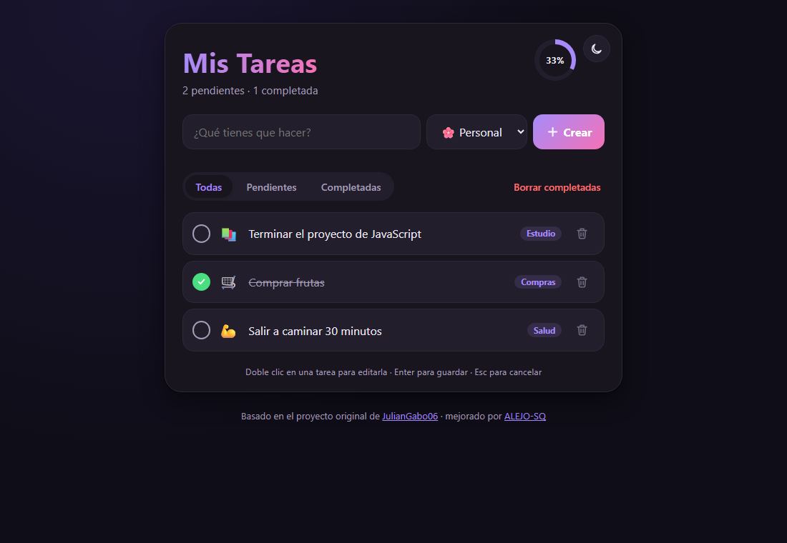

# ✅ Mis Tareas

**Lista de tareas con categorías, filtros, edición en línea, progreso y guardado automático**

## ✨ Características

- ➕ Crea tareas con **Enter** o con el botón, con validación sin `alert()`
- 🏷️ **Categorías con emoji**: personal, trabajo, estudio, hogar, compras y salud
- ✅ Marca tareas como completadas y ve tu avance en un **anillo de progreso**
- ✏️ **Edita** con doble clic (o Enter / F2 con teclado); Esc cancela
- 🔎 Filtros: todas, pendientes y completadas
- 🧹 Borra de una vez todas las completadas
- 💾 Todo se guarda en `localStorage`
- 🌗 Modo claro / oscuro
- 📱 Responsive y ♿ accesible: botones reales con `aria-label`, `aria-pressed`, foco visible y `prefers-reduced-motion`
- 🛡️ El texto de las tareas se inserta con `textContent`, sin riesgo de inyección de HTML

## 🔧 Qué se corrigió respecto a la versión anterior

- Lo que escribía el usuario se usaba como **nombre de una imagen** (`imagenes/<texto>.jpg`), así que casi siempre salía una imagen rota
- `let = tarea = ...` creaba una variable global por error
- No funcionaba con Enter, no guardaba nada al recargar y el documento estaba marcado en inglés
- Se retiraron las imágenes de terceros (incluida una de un personaje con derechos de autor)

## 🚀 Correr en local

Abre `index.html` en el navegador.

## 🙌 Créditos

Basado en el proyecto original de [JulianGabo06/Task-list](https://github.com/JulianGabo06/Task-list), rediseñado y ampliado por [ALEJO-SQ](https://github.com/alejo234506).
